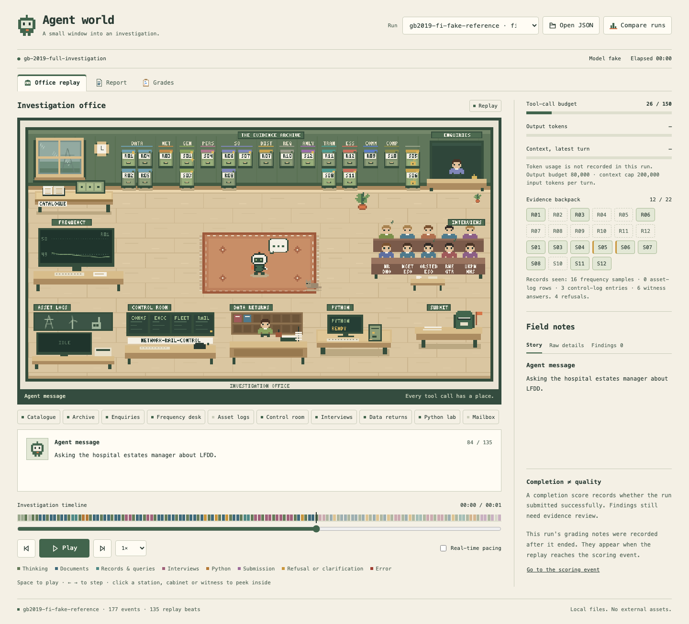

# Incident response

A [Karotte](https://github.com/preferencemodel/karotte) environment in which an AI agent
investigates the GB power cut of 9 August 2019. The agent gathers evidence with tools,
analyses real frequency data in Python, and submits a cited report that keeps established
mechanisms separate from unresolved causes.

The repository also ships **Agent world**, a pixel-art viewer for watching runs replay
or follow them live.



## Tasks

Three one-step tasks, each a superset of the one before. The earlier tasks stay frozen as
regression baselines.

| Task id | Scope | Tools | Tool-call budget |
| --- | --- | --- | --- |
| `gb-2019-electrical-disturbance` | MVP: the initiating fault, generation trips and frequency excursion, over five records | 4 | 50 |
| `gb-2019-system-response` | Adds the power-system response and demand restoration: asset logs, control rooms, witnesses and data returns | 9 | 150 |
| `gb-2019-full-investigation` | The whole incident, including rail and essential-service impact, communications, compliance and recommendations, over 22 documents | 9 | 150 |

Evidence mixes real public data (NESO frequency, Elexon, Network Rail, ORR) with
digitised official figures and clearly labelled reconstructions. Each task's README in
`my_env/src/environment/tasks/gb_2019_*/` covers its prompt, tools, budgets, isolation and
grading.

**Scoring is completion only**: `1.0` for a valid submission within budget, otherwise
`0.0` with a reason. Quality grades (content coverage, evidence support, assertion
quality) are written to `grade.json`. They stay provisional until the answer keys pass
domain review and a human signs off on each run.

## Layout

```
my_env/
  src/environment/
    tasks/          task definitions (prompt, judge, reference submissions)
    tools/          thin MCP tool adapters
    incident/       episode core, bundles, grading, LLM judge, CLI
      bundle/       MVP evidence bundle
      bundles/      system_response and full_investigation bundles
      private/      answer keys and provenance (grader-only)
  builder/          scripts that rebuild and verify the evidence bundles
  viz/              Agent world viewer (single HTML file + stdlib server)
  configs/          fake, live and panel run configs
  docs/             MVP guide, design decisions, reviewer pack
  tests/
```

## Getting started

Run everything from `my_env/`:

```sh
cd my_env
uv sync --extra dev
uv run just --list
```

Common commands:

```sh
uv run just test                                  # full test suite
uv run just lint                                  # ruff + supply-chain checks
uv run karotte run --config configs/fake_run.json # scripted fake agent, no model cost
uv run python -m environment.incident.cli list    # verify and list the MVP bundle
uv run python -m environment.incident.cli replay out/<run>_artifacts/episode
```

Each task has fake-model scenarios (`reference`, `repair`, `no_submission`,
`isolation_probe`) in `configs/*_fake_*.json`. The `*_live_run.example.json` configs
make real model calls and cost money.

## Agent world

```sh
uv run just viz 8808                          # replay saved runs under out/
uv run just viz-live root_data/episode 8808   # follow a running episode
```

The viewer opens at `http://127.0.0.1:8808/`. Every tool call has a station in the
office: the catalogue desk, archive cabinets, frequency desk, interview corner, Python
bench and mailbox. The **Report** and **Grades** tabs show the submitted report with
resolvable citations and the provisional grade. `/compare` lays out every saved run
by topic. See [`my_env/viz/README.md`](my_env/viz/README.md) for details.

## Contributing

See [`AGENTS.md`](AGENTS.md). Any change to tools, evidence, schemas or run artifacts
must update Agent world in the same change.
